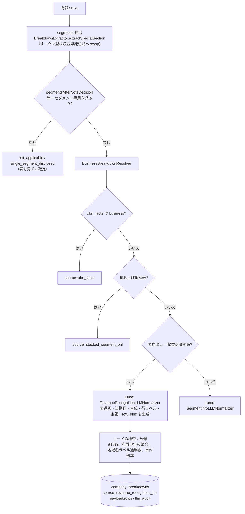
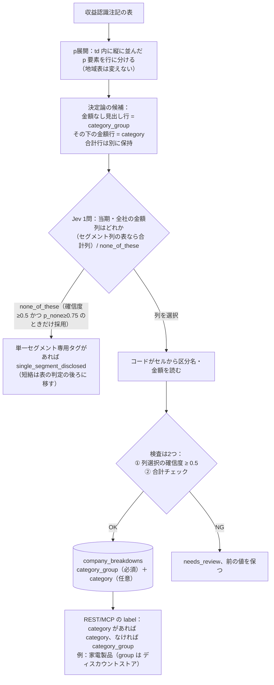

<!-- 移行元: 旧課題管理のドキュメント。正本はこのファイル。件数の最新値は書かない。 -->

# 収益認識注記Breakdown：決定論＋Luna → 決定論＋Jev 実装レポート

> 履歴スナップショット（2026-10-03）。当時の「PR は open」「Luna が生成している」は動かさない。現行の経路は決定論＋Jev（収益認識・事業別・地域別）。件数はここに更新しない。
>
> 作成：2026-10-03 10:30 JST頃。main `b03d1f3`（2026-10-03 08:55 JST）、Neon `[redacted]`（default ブランチ、SELECT のみ）、box の `/workspace/jev-rr-test` と `/workspace/poc-jev`、各社の価格ページから作成。数値はすべて出典つき。推定値には **推定** と書き、計算式を添えた。
>
> 更新：2026-10-03 11:00 JST頃。PR Replace revenue-recognition Luna step with Jev column choice のライブ Jev 検証（`/workspace/pr471/threshold/`）を反映した。7章「実データ検証（ライブJev）」を追加し、要約・5章・6章（比較表・費用）・8章（今後）を更新。ラベルの未決事項は決定済みなので削除した。
>
> 更新：2026-10-03 11:25 JST頃。9章「参考：セグメント情報（外部顧客への売上高）へのJev適用試験」（box のみの実験）を追加し、8章（今後）を PR の現状と構造判定の4段階ルールで更新した。

## 1. 要約

* 収益認識注記「収益の分解」の事業別内訳は、今は決定論の表抽出のあと **Luna（GPT-5.6 Luna）** が行・区分名・金額・単位を **生成** している。新しい構成では、区分名・金額・合計はすべてコードが表のセルから取り、**Jev（typesafe/jev-1.13）は「当期・全社の金額列はどれか（どれでもない）」の1問だけ** に答える。
* 理由は精度と保守性。本番DBでは、区分名が1行ずつずれた書類（7413 S100YKKP、needs_review なし）や、単位が1,000倍になった書類（272A S100YSCR）が見つかっている。どれも Luna が行を作る構成と、`
` を区切りなしで連結する抽出から生じている。プロンプトにはパンパシHD専用の例外文もある。
* 費用：1書類あたり Luna 約 $0.00092（**推定**）→ Jev 約 $0.000062（実測、列の設問のみ。既存のセグメント注記工程の呼び出しを含めると約 $0.00012）。296書類を1回取り込む費用は、約 $0.27（推定）→ 約 $0.018（実測、含めると約 $0.037）。どちらも小さい金額なので、変更の主な目的は費用ではない。
* 状況：PR Replace revenue-recognition Luna step with Jev column choice（`cursor/revenue-recognition-jev-0956`）が open。`3a9a1f72` でライブ検証した（Sources は `2f6c76ae` と同一）。
  * 7書類の smoke：区分・金額まで全件一致。
  * 本番296書類：誤った列は0。誤った none_of_these が7件あったが、判定ルールの変更で全件拾える。
  * 合計行が区分として入るなど、別の不具合を 実装側が修正中。
  * 10/3 11:15 JST 時点で、PR はまだ通っていない（CI 失敗。8章）。
* 参考（9章、box だけの実験で PR には入っていない）：セグメント情報表の「外部顧客への売上高」にも Jev を試した。正解は Jev＋コード 231/258、本番 Luna 207/258。ただし地域別を選ぶ誤りは確信度で止められず、方針をコードに書くのが先。本番 DB には単位を誤った値（×1,000 など）が35件あり、別途対応が要る。

## 2. 現状（決定論＋Luna）の構成

* **呼び出し箇所**：`Sources/BlueTicker/Analysis/BusinessBreakdownResolver.swift` の74行目（`RevenueRecognitionLLMNormalizer.normalize`）。プロンプトとスキーマは `Sources/BlueTicker/Analysis/RevenueRecognitionLLMNormalizer.swift`。システムプロンプトは約3,000字。
* **モデル**：`ChatCompletionClient.swift` が `LLM_PROVIDER` と `OPENAI_BUSINESS_MODEL` を読む。`.env.example` は `LLM_PROVIDER=openai`、`OPENAI_BUSINESS_MODEL の場合は `reasoning_effort: "none"`、strict json_schema で呼ぶ。本番の値は fly secrets かローカルの ingest 環境にあり、box からは見られない。旧チケット 105 の補足（10/3）にある「GPT-5.6 Luna」と、`.env.example` の値は一致している。
* **LLM が決めていること**：使う表（`source_table_index`）、当期の列（`period_column`）、単位（`unit`）、各行の区分名（`label`）・金額（`amount`）・行の種類（`row_kind`：segment / subtotal / reconciling）、該当するかどうか（`applicable`）、根拠メモ（`notes`）。**行・区分名・金額はすべて LLM の出力** で、コードは事後に検査するだけ。
* **保存先**：`company_breakdowns`（axis=business、source=`revenue_recognition_llm`、`payload.rows`）。`llm_audit`（jsonb）には unit / notes / periodColumn / profitDisclosed / sourceTableIndex だけが入る。**モデル名・トークン数・費用は保存されていない**（スキーマとキーを実際に確認した）。
* 補足：依頼に書かれていたパス `Sources/BlueTickerCore/Analysis/XBRL/Breakdown/` は main に存在しない。該当するファイルは `Sources/BlueTicker/Analysis/` の下にある。

## 3. 現状の課題（DB の実例つき）

### 3.1 7413 S100TRF1 / S100W5B9：表があるのに行数0

* 9/28 21:38 JST 頃の `breakdown-business-v13` では、両書類とも `not_applicable` / reason `unknown` / `needs_review=true` / rows 0 / `llm_audit` なし（旧チケット 105 に 9/30 の読み取り記録がある。その後 DB は上書きされ、当時の行は残っていない）。
* **今の DB**（v14、10/2 00:31 JST 更新）：両書類とも `not_applicable` / `single_segment_disclosed` / `needs_review=false` / rows 0。`llm_audit.jev` は `decisionSource: dedicated_single_segment_tag`、`calls: []`。
* 原因：`BltServerFacade.swift` 551行目の `segmentsAfterNoteDecision` が、単一セグメントの専用タグを見つけると収益分解表を見る前に `nil` を返して終わる。PDF には7区分の表がある（レビュー担当 の期待値：TRF1 合計 4,883,573千円、W5B9 合計 4,950,632千円）。
* 同じ会社の S100OGEM（9行）、S100R40S（7行）、S100YKKP（10行）は v13 の `revenue_recognition_llm` のまま表が出ている。

### 3.2 1つの td に縦に並んだ `
` が連結される

* `BreakdownExtractor.expandTable`（790行目）は、セルの文字列を `bs4Text` で作る。`bs4Text` は子孫のテキストを **区切りなしで連結** する。7413 S100YKKP の生 HTML では、1つの td に金額7件が `
` で縦に並んでいる（461,229 / 1,748,028 / …）。この形だと、区分名も金額も1本の文字列になって Luna に渡る。
* Luna がそれを推測で分割した結果、本番 DB に入っている値：

| 書類 | DB（Luna 出力） | PDF の正しい値 |
| -- | -- | -- |
| 7413 S100YKKP | 油脂 410,483／乳製品 1,592,960／調味料 1,080,049／…／栄養補助食品 55,945／その他 0 | 油脂・乳製品 410,483／調味料 1,592,960／嗜好品・飲料 1,080,049／…／その他 55,945 |
| 7413 S100R40S | 油脂 474,540／乳製品 1,622,478／調味料嗜好品・飲料 1,006,172 | 油脂・乳製品 474,540／調味料 1,622,478／嗜好品・飲料 1,006,172 |
| 5237 S100W6GR | 押出成形セメント製品／関連スレート／関連耐火被覆等 | 押出成形セメント製品関連／スレート関連／耐火被覆等 |
| 272A S100YSCR | 工事／表示板・標識／…／その他商品サインメディア | 工事表示板・標識／…／その他商品／サインメディア |

（金額の単位：7413 は千円の表。DB の値は円換算後なので、表の数字に戻して記載した。）

* **S100YKKP は7区分すべての区分名が1つずつずれているのに、**`needs_review=false` **で公開されている。** 金額の並びは正しいので合計は合い、今の検査（分母±10%）では見つけられない。
* 272A S100YSCR は単位も誤っている。LLM が `million_yen` と申告し、「工事」が 1,698,931,000,000円、売上分母は 29,857,236,000円になった。`llm_row_sum_mismatch` で needs_review になり、REST では 404（未算出）。
* Luna の `notes` に「連結して」「分割」「抽出崩れ」などを含む `revenue_recognition_llm` の行は15件（キーワード検索なので誤検出を含むかもしれず、全件の目視はしていない）。

### 3.3 金額のない見出し行（区分グループ）の扱い

* 汎用のルールはない。プロンプトの「例外（パンパシHD型）」1段落だけが「大枠見出しは出さず、子にラベルとして付ける」と指示している。
* 7532 S100WR05（DB）では、品目に「家電製品（ディスカウントストア）」のように親が付く一方、「（海外）」の下の **北米・アジアは親なし** で segment になっている。「その他の収益（注）１」も segment として入っている。
* 272A S100YSCR と 5237 S100W6GR でも、「その他の収益」が segment（事業区分）として出力されている。見出しや合計に近い行が区分として扱われる例である。
* LLM が小計を作り出した例は、今回の DB 確認では特定できなかった（未確認）。

### 3.4 会社別の例外がプロンプトに入っている

* `RevenueRecognitionLLMNormalizer.swift` の31行目に「**例外（パンパシHD型）**：行が「（ディスカウントストア）」「（総合スーパー）」のような大枠見出し…」がある。206行目（地域ラベルのガード）と `BreakdownExtractor.swift` の985行目にも、パンパシHD型を前提にしたコメントと処理がある。
* 似た形の会社が出るたびに、プロンプトに例外を足すことになる。どの会社にどの例外が効いているかは、コードを読まないと分からない。

### 3.5 LLM が行を作ることによる幻覚リスクとテストのしにくさ

* 区分名・金額・単位・行の種類がすべて LLM の出力なので、3.2 のような「それらしいが間違った値」が入る。コードの検査（分母±10%、利益申告の整合、地域名の過半数、単位倍率）は合計と形しか見ないため、区分名のずれは止められない。
* 既存テスト（`RevenueRecognitionLLMNormalizerTests.swift`）は LLM の応答をモックにして、正規化器の検査だけを確かめている。Luna が正しい行を返すかどうかは CI では確かめられない。

### 3.6 全体の数字（Neon、10/3 10:2x JST）

| 項目 | 件数 |
| -- | -- |
| business 軸の行（全 source） | 2,820 |
| `revenue_recognition_llm` | 296書類（162社）。うち needs_review **48**（16.2%） |
| 警告 `unit_header_llm_mismatch` | 94 |
| 警告 `llm_row_sum_mismatch` | 42 |
| 警告 `llm_unit_unresolved` | 6 |
| 警告 `business_label_mismatch` | 1 |
| business の `not_applicable` | 261（single_segment_disclosed 220、geography_only 36、unknown 4（すべて needs_review）、not_found 1） |
| business の needs_review（全 source） | 80 |

（比較用：`segment_info_llm` は274行で、同じ business 用の Luna クライアントを使う。）

## 4. 現状の費用感（Luna）

`llm_audit` にトークン数がないため、**プロンプトの長さから推定した**。トークン化は tiktoken `o200k_base` で代用した（[redacted] のトークナイザは公開されていない）。

* 価格（[https://developers.openai.com/api/docs/models/[redacted]](<https://developers.openai.com/api/docs/models/[redacted]>) 、10/3 取得）：入力 $0.20、キャッシュ済み入力 $0.02、出力 $1.20（いずれも 100万トークンあたり）。
* 入力（**推定**）：システムプロンプト 2,118＋JSON スキーマ 191＋ユーザープロンプト（7書類の実際の表から `llmUserPrompt` の形式で再構成）平均 488 ＝ **約2,797トークン/書類**（範囲は 2,555〜3,439）。
* 出力（**推定**）：DB の296書類分の rows＋notes を出力 JSON の形に組み直すと、平均717字。サンプル2件の実測比（1,883字 ÷ 776トークン ＝ 2.43字/トークン）から **約296トークン/書類**。参考：9月の簡易プロンプトでの実測は、5237 S100W6GR で入力950・出力290トークン。
* 1書類あたり（**推定**）：2,797 × $0.20/1M ＋ 296 × $1.20/1M ＝ $0.000559 ＋ $0.000355 ＝ **約 $0.00092**。
  * システムプロンプトがキャッシュに当たった場合：2,309 × $0.02/1M ＋ 488 × $0.20/1M ＋ $0.000355 ≒ **$0.00050**（下限の目安。キャッシュ書き込みは入力単価の1.25倍）。
* 全社（**推定**）：296書類 × $0.00092 ≒ **$0.27/全件1回**（キャッシュが当たれば ≒ $0.15）。
  * この296は「今 `revenue_recognition_llm` として保存されている書類」の数。Luna が `applicable=false` を返した書類は audit が保存されないため数えられず、**実際の呼び出しはこれより多い**。cache_version を上げて取り込み直すたびに、同じだけかかる。

## 5. 新構成（決定論＋Jev）

* **Jev に聞くのは1問だけ**：「当期の全社金額はどの表のどの列か（セグメントが列に並ぶ表なら合計列）。該当がなければ none_of_these」。行・区分名・グループ・金額は、すべてコードが候補とセルから取る。Jev は文字列を生成しない。
* **検査は2つだけ**
  1. 列選択の確信度が **0.5** 未満なら needs_review にし、前の値を保つ。none_of_these は「確信度 ≥ 0.5 かつ p_none ≥ 0.75」のときだけ採用し、それ以外は確信度が最も高い列を使って needs_review にする。根拠は7.3（当初案の約0.6から、実データで変更した）。
  2. 合計チェック：|項目の和 − 小計| ≤ 項目数 × 表の1単位。7413 は7項目で4千円の差なので通る。
* **3つのパターン**
  1. グループのみ。
  2. グループ＋「うち」付きの一部項目。表示専用で、合計チェックはしない。
  3. グループ＋全項目。小計があるときだけ合計チェックをする。7532 のように見出しに金額がない形もここに入る。
  * 和が足りないことから「一部項目」と推測はしない。その場合は needs_review。
  * 合計は、グループに金額があればその金額、なければ項目の和。両方を足すことはしない。
* **DB とラベル**：DB には `category_group`（必須）と `category`（任意）だけを保存する。`label` は保存しない。
  * Sorahiro 決定（10/3）：結合ラベルは作らない。REST/MCP の `label` は、category があれば category、なければ category_group。
  * iOS は両方を取得し、category を group の下に入れ子で表示する（旧チケット 110）。
  * 後で結合表示が必要になっても、REST は変えない。
* **単一セグメントの短絡**：表の判定の後ろに移す。1711 / 8771 / 4704 の結果は変わらないこと。
* **Luna**：この経路から呼び出し・プロンプト・パンパシHD例外文を削除する。フラグや Luna に戻す道は残さない。
  * **注意**：`OPENAI_BUSINESS_MODEL` を読む business クライアント（`businessChatClient`）は `SegmentInfoLLMNormalizer`（`segment_info_llm`、274行）でも使われている。そちらを残すなら、この env は削除できない（「他に呼び出し元がなければ削除」という条件には当てはまらない）。

## 6. 比較表

| 項目 | 現状（決定論＋Luna） | 新構成（決定論＋Jev） |
| -- | -- | -- |
| LLM の役割 | 表選択・当期列・単位・区分名・金額・行種別を生成 | 当期・全社の金額列を選ぶだけ（none_of_these あり） |
| 幻覚リスク | あり。区分名ずれ（7413 YKKP）、単位1,000倍（272A YSCR） | 選択肢から選ぶだけで文字列も数値も作らない。誤選択は確信度と合計で検出 |
| テストのしやすさ | LLM 出力をモックするしかなく、Luna の正しさは CI で確かめられない | 候補と最終行を golden で固定でき、Jev は列IDを1つスタブするだけ |
| 会社別の例外 | プロンプトにパンパシHD例外文がある | なし（見出し行のルールに一本化） |
| needs_review の条件 | 分母±10%、利益申告の不整合、地域名の過半数、単位の推定不能 など | 列の確信度 < 0.5（none_of_these は確信度 ≥ 0.5 かつ p_none ≥ 0.75 のときだけ採用）／合計が丸め幅を超える。セグメント注記工程の 0.9 しきい値は従来どおり残る（7.5） |
| 1書類あたりの費用 | 約 $0.00092（**推定**、キャッシュ時 約 $0.00050） | 約 $0.000062（実測、列の設問のみ）／約 $0.00012（実測、セグメント注記工程を含む） |
| 全社の費用（296書類×1回） | 約 $0.27（**推定**） | 約 $0.018（実測、列のみ）／約 $0.037（実測、296書類の回の総額） |
| 実測精度 | 系統的な評価なし。DB では needs_review 48/296、区分名ずれ・単位1,000倍の実例あり | 本番296書類：列の設問まで到達した282件中、正解273・誤った列0・誤った none_of_these 7（新ルールで全件拾える）・保留2。7書類 smoke は区分・金額まで全件一致 |
| 保守性 | 3,000字のプロンプトと例外文を育て続ける | 決定論のルールとテストで直せる。LLM の設問は1つ |

Jev の費用：価格は [https://openrouter.ai/typesafe/jev-1.13](<https://openrouter.ai/typesafe/jev-1.13>) （10/3 取得）で、入力 $0.042/1M、出力 $0。

* 実測（7.6）：列の設問は282回で入力 418,978トークン（平均1,486）。418,978 × $0.042/1M ≒ $0.0176、1回あたり約 $0.000062。事前の推定（平均1,437トークン、全社 $0.018）とほぼ同じだった。
* セグメント注記工程の呼び出しは今の本番にもすでにあるので、Luna との差に効くのは列の設問の分だけ。

## 7. 実データ検証（ライブJev）

> PR [#471](https://github.com/sollahiro/blue-ticker/pull/471) の `3a9a1f72` で実施した。`2f6c76ae` とは Sources が同一（差分はテスト1ファイルだけ。git diff で確認）。
>
> Jev は TypeSafe API に直接つないだ（モデル jev-1.13.0。本番の指定は `typesafe/jev-1.13`）。本番 DB への書き込みはしていない。
>
> データ：`/workspace/pr471/threshold/`（live_jev_rr_296.csv、sum_check_failures.csv、live_jev_calls\_\*.jsonl）。7書類の採点は `/workspace/pr471-smoke/`。数値はすべて CSV と jsonl から再集計した。
>
> 検証のあと、PR の先頭は `cd89b05e` に進んでいる（10:43 JST、実装側が修正中）。この先頭はまだ検証していない。

### 7.1 7書類の smoke

| 書類 | 選んだ列 | 確信度（1回目／2回目） | 区分・金額 |
| -- | -- | -- | -- |
| 7413 S100YKKP | t0_c1 | 0.96／0.97 | 一致（7区分） |
| 7413 S100R40S | t0_c1 | 0.96／0.97 | 一致 |
| 7413 S100TRF1 | t0_c1 | 0.96／0.97 | 一致 |
| 7413 S100W5B9 | t0_c1 | 0.94／0.97 | 一致 |
| 5237 S100W6GR | t0_c2 | 0.99／0.99 | 一致（4区分） |
| 272A S100YSCR | t0_c1 | 0.69／0.94 | 一致（6区分） |
| 7532 S100Z42G | t0_c4 | 1.0／1.0 | 一致（15項目。和 2,365,707百万円 ＝ 顧客との契約から生じる収益。PDF と完全一致） |

* 本番の不具合2件が、この経路では直っている。
  * 7413 YKKP：「油脂・乳製品 410,483千円」（本番 DB は「油脂 410,483」）。
  * 272A YSCR：「工事表示板・標識 1,698,931千円」＝1,698,931,000円（本番 DB は 1,698,931,000,000円）。
* 7413 TRF1 / W5B9 は、単一セグメントの短絡を後ろに移したことで7区分が出る。合計 4,883,573千円／4,950,632千円との差はどちらも4千円で、丸め幅に収まる。
* 272A YSCR の確信度は、同じ入力でも 0.69／0.94／0.87（3回目は296書類の回）とばらついた。しきい値の近くでは結果が揺れうる。
* 5237 W6GR は区分・金額とも正しいが、needs_review になった。原因は列の選択ではない。セグメント注記工程の Jev の確率 0.8 が、しきい値 0.9 を下回ったため（7.5）。
* 2回の合計で28回呼び出し、エラー0、入力 40,180トークン。

### 7.2 本番296書類での列選択

対象は、本番 DB で `revenue_recognition_llm` になっている296書類（162社）。

| 結果 | 件数 |
| -- | -- |
| 列の設問まで到達 | 282 |
| うち 正しい列 | 273 |
| うち 誤った列 | **0** |
| うち 誤って none_of_these | 7 |
| うち 判断保留 | 2 |
| 列の設問まで到達せず | 14 |

* 判断保留の2件は 4519 S100QH69 / S100NR8W。「その他の源泉」を含む合計列と顧客契約の列のどちらが正しいか決めきれず、見出しにもずれがある。
* 到達しなかった14件は 2480、3442、4074、4167×4、4481×4、6074、9348、9423。金額列が見つからなかったか、セグメント注記工程が収益認識以外の表を残してセグメント情報経路へ回した。セグメント情報経路は今回動かしていない。
* 誤った none_of_these の7件は、どれも「報告セグメントが1つで、その列が全社」という表だった：1436、4431、5247、7050×4。
  * 確信度は 0.02〜0.47、p_none は 0.51〜0.72。
  * 次点はどれも具体的な列で、6件は正しい列と自動照合で一致した（7050 S100OSYV には照合キーがない）。
* 正しい列を選んだ273件の確信度：最小 0.06、5パーセンタイル 0.50、10パーセンタイル 0.63、25パーセンタイル 0.92、中央値 0.98。
* 確信度が低い正解は、同じくらい正しい選択肢が2つある表が多い。
  * 7567：colspan で同じ列が2つあり、確率が割れる（0.47〜0.57）。
  * 6902 / 1914 / 5214：使える表が2つある（例：1914 S100YGM2 は 0.44 対 0.42）。

しきい値ごとに、正しい選択が needs_review になる件数（273件中）：

| しきい値 | 0.5 | 0.6 | 0.7 | 0.75 | 0.8 |
| -- | -- | -- | -- | -- | -- |
| 件数 | 14 | 23 | 35 | 37 | 41 |

### 7.3 データからの決定

* 列のしきい値は **0.5** にする（テストした PR は 0.6）。0.5 でも、正しい選択のうち14件（5.1%）は needs_review になる。
* none_of_these は **確信度 ≥ 0.5 かつ p_none ≥ 0.75** のときだけ採用する。それ以外は確信度が最も高い列を使い、needs_review にする。
  * 今回の誤り7件は、これですべて拾える（確信度は最大 0.47、p_none は最大 0.72）。
* 注意：今回の296書類には、本当に none_of_these が正解になる書類がなかった。省略側の確認は、1711 / 8771 / 4704 で別に行う。

### 7.4 見つかった別の不具合（PR [#471](https://github.com/sollahiro/blue-ticker/pull/471) で 実装側が修正中）

1. **合計行が区分として保存される。**
   * 表全体の和を確かめると、28書類（17社）で合わない。そのうち20書類は needs_review=false のまま。
   * 合計行の表記ゆれ：外部顧客に対する売上高（6904、7276）、外部顧客への収益（7114）、小計（3148）、売上高（6257）。
   * ほかに、ZOZO（3092）の括弧付き子項目（「（買取・製造販売）」など）と、1807 の折り返しラベル（「一時点で移転される財又は」「サービス」が2行に分かれる）。
2. **列は正しいのに行が出ない**（いずれも not_applicable になる）。
   * 7416×4：区分名が2列目にあり、1列目が空。
   * 6482 S100YJC5：`
` 展開がずれる。
   * 6615 S100YK9A：表が分割され、合計だけの断片を選んだ。
3. `llm_audit` **の記録が上書きされる。** 列選択の記録が、セグメント注記工程の記録で上書きされる（列選択は notes に残るだけ）。

### 7.5 needs_review の内訳

* 取り込めた269書類のうち、116件が needs_review。
* 列のしきい値（0.6）が原因なのは21件。残りの95件は列でも合計でもなく、セグメント注記工程（`breakdown_table`、しきい値 0.9）が原因と見られる。この工程の呼び出し255回のうち、145回は確信度が0.9未満だった。
* 今回の変更の範囲外だが、公開できる件数に大きく効くので、別に見直す（後続）。

### 7.6 費用（実測）

* 3回分（7書類×2回、296書類×1回）の合計：569回、エラー0、入力 915,640トークン。TypeSafe の価格 $0.042/1M（出力は無料）で約 $0.038。
* 296書類の回：541回（列の設問282、セグメント注記255、省略理由4）、入力 875,460トークン → $0.0368。1書類あたり約 $0.00012（セグメント注記工程の呼び出しを含む）。
* 列の設問だけ：282回、入力 418,978トークン → $0.0176。1回あたり約 $0.000062。
* OpenRouter 経由の請求額は、TypeSafe 直と違う可能性がある（掲載単価はどちらも $0.042/1M）。

## 8. 検証状況と今後

**box での事前検証（ライブ検証より前、10/3、読み取りのみ、**`/workspace/jev-rr-test`**）**

* モデルは jev-1.13.0。TypeSafe API に直接つないだ（本番は OpenRouter の `typesafe/jev-1.13`）。28回呼び出し、エラー0。入力は計129,328トークンで、$0.042/1M を掛けると **$0.0054**。この28回には、新構成で不要になった行選択（step 2）の14回も含まれる。
* 列選択は7書類すべて正解で、選択肢の順序を入れ替えても同じだった。確信度（順方向／逆方向）：
  * 7413 YKKP 0.96/0.91、TRF1 0.97/0.89、W5B9 0.97/0.89、R40S 0.96/0.93
  * 5237 W6GR 0.99/0.99
  * 272A YSCR 0.83/0.75（ヘッダー行がなく、期間がキャプションにしかない）
  * 7532 Z42G 1.0/1.0
* 区分名・金額・合計は6書類で期待値と完全一致した（YKKP 4,751,616／TRF1 4,883,573／W5B9 4,950,632／R40S 4,846,130／W6GR 21,914,415（外部顧客 21,954,062）／YSCR 21,925,876）。
* 7532 S100Z42G（入れ子）：15項目すべて正解。和 2,365,707 ＝ 顧客との契約から生じる収益、その他の収益 79,554、外部顧客への売上高 2,445,260（百万円）。レビュー担当 が PDF の137ページと照合済み。なお 7532 S100Z42G は、まだ本番 DB に入っていない（7532 の最新の business 行は S100WR05）。
* 9/26 の Jev PoC（`/workspace/poc-jev`）：計1,389回、エラー0、$0.084。
  * 表選択：70書類で、比較できた33件中31件が現状と一致（93.9%）。
  * セル選択：数字一致84.4%（359回、連結されたままの表）。
  * タグ分類：ShareholdersEquity を BPS と誤る例が15件あり、不採用。このため今回の構成では、Jev には列を選ばせるだけにしている。

**これから**

PR [#471](https://github.com/sollahiro/blue-ticker/pull/471) はまだ通っていない（10/3 11:15 JST 時点）。

* 先頭は `097015f0`（11:06 JST に push）。CI は swift-macos が失敗（11:11 JST）、swift-linux は実行中、repo-invariants と ios-paths は成功。
* 残っている問題：
  * デンソー：ラベル領域が2列ある。
  * 東京エレクトロン：並列の切り口（次元）が同じ表にある。
  * 三菱：分母。
  * 8771：退行。
* none_of_these の採用条件としきい値 0.5（7.3）は、まだコードに入っていない（PR の説明も 0.6 のまま）。
* `ce264d66` では、7書類の smoke と golden は通っている。

次の順で進める。

1. **Jev の前に、表の構造をコードで判定する（Sorahiro さんの4段階ルール）。**
   1. ラベル領域は1列か2列か。
   2. グループ（category_group）と項目（category）。
   3. 小計とセグメント。
   4. 並列の切り口（製品別と地域別など）は、決して合算しない。
2. 上の4件と 7.4 の不具合を直し、none_of_these の採用条件としきい値 0.5 をコードに入れる。
3. CI を通し、本番296書類のライブ検証をやり直す。
4. レビュー担当の確認 → GO → マージ。

* CI golden（7書類。Jev の回答はスタブ）は PR に入っている。
* 別件：セグメント情報表の「外部顧客への売上高」への Jev 適用は、box で試した（9章）。PR [#471](https://github.com/sollahiro/blue-ticker/pull/471) の範囲外。
* 後続：セグメント注記工程の 0.9 しきい値による needs_review（95件）を見直す。
* 後続：本番の `segment_info_llm` の単位の誤り35件（9.7）。

**マージ後（どれも Sorahiro さんの個別の OK が必要）**

1. DB migration（`category_group` / `category` の追加）の適用。
2. 該当書類の再取り込み。

関連：旧チケット 105（本件）、旧チケット 85（Jev の適用範囲。「行の生成は Luna、Jev は Choice だけ」の記述を、PR を出す前に更新する予定）。

## 9. 参考：セグメント情報（外部顧客への売上高）へのJev適用試験

> **box だけで行った実験で、PR** [#471](https://github.com/sollahiro/blue-ticker/pull/471) **には入っていない。** 本番 DB への書き込みもしていない。
>
> データ：`/workspace/pr471/segment_jev/`（README.md、judged.csv、live_jev_seg_eval.csv / .json、live_jev_seg_calls.jsonl）。数値はすべてこれらのファイルから再集計した（10/3 11:20 JST頃）。正誤は、表を見て人手で付けた判定（[judge.py](<http://judge.py>) に記録）。
>
> 比較相手の「本番 Luna」は、本番 DB にある `segment_info_llm` の行。

**結論**：Jev＋コードの正解は 231/258（89.5%）で、本番 Luna の 207/258（80.2%）より多い。ただし、確信度でも合計チェックでも止められない誤り（地域別の選択）が6件あり、今のままでは置き換えられない。9.6 の決定論の関門をコードに入れれば、置き換えられる見込みがある。

### 9.1 方法

* 決定論の抽出（`LocalSegmentInfoDumpTests.swift`、ネットワークなし）→ 候補を作る（seg_lib.py：行・列・積み上げの候補。「合計が損益計算書の売上高と一致」の注記と合計チェックはコードが付ける）→ Jev に1問（外部顧客への売上高はどの候補か／none_of_these）→ geo_pass.py（選んだ候補が地域だけなら、地域の候補を外して聞き直す）→ 本番 Luna の行と比較 → 人手で判定。
* モデルは jev-1.13.0（TypeSafe API に直接接続）。区分名と金額は、コードが表のセルから読む。

### 9.2 対象

| 区分 | 書類数 |
| -- | -- |
| 今の `segment_info_llm` 経路 | 172 |
| 単一セグメントの短絡で省略される書類（短絡を外して実行） | 86 |
| **対象 計** | **258** |
| 対象外（収益認識経路に行く、表がない など。野村など） | 17 |

### 9.3 結果

| 判定 | 件数 | Jev＋コード | 本番 Luna |
| -- | -- | -- | -- |
| 一致 | 181 | 正 | 正 |
| Luna が誤り、Jev が正しい | 42 | 正 | 誤 |
| Luna が誤り、Jev が正しく none | 8 | 正 | 誤 |
| Jev の取りこぼし（none と回答） | 9 | 誤 | 正 |
| Jev が地域別を選んだ | 5 | 誤 | 正 |
| 表は正しいが行が誤り | 4 | 誤 | 正 |
| 粒度が違うがどちらも妥当 | 4 | ― | 正 |
| 判断保留 | 4 | ― | 正 |
| 両方誤り | 1 | 誤 | 誤 |
| **計** | **258** | **231** | **207** |

* Luna の 207 は、「粒度違い4」と「判断保留4」も Luna の正解に数えた値で、Luna に有利な数え方。この8件を除くと Luna は 199。粒度違いを両方の正解に数えると Jev 235、Luna 203。どの数え方でも Jev のほうが多い。

**Luna が誤りで Jev が正しい42件**

* **単位の誤り 35件**：千円の表を百万円として扱ったもの など。×1,000 が27件、×1,000,000 が7件、×1/1,000 が1件（表の単位は千円30件、百万円5件）。9.7 も参照。
* 資生堂の分割された表 3件：Luna は2区分だけ。Jev＋コードの結合では8区分になり、合計も合う。
* 武田：アドベイトの当期は表では 122,911。Luna は 305,297（別の行の値）。
* 前期の値 1件：表の当期は 茸事業 37,471／その他 373。Luna は 36,779／322。
* Luna が地域別、Jev が事業別（広告業／情報サービス業）1件。Luna が「その他」を落とした 1件。

**Luna が誤りで Jev が正しく none の8件**

* オムロン 5件：抽出で前期（第N-1期）の表しか取れておらず、Jev は none、Luna は前期の値を出した。抽出側の修正が必要。
* TDK 1件：金額のない表しか抽出されず、Luna の金額は入力に根拠がない。
* ほかに、前期の表しかない 1件、Luna が同じラベルを4回出した 1件。

**Jev の誤り**

* 取りこぼし 9件
  * SMFG 4件：連結粗利益の行は候補にあったが、Jev は none（確信度 0.49〜0.59）。銀行は粗利益を使う、というルールがコードに必要。
  * 製品の表が候補になかった（地域の表だけ）1件、製品×地域の表を候補にしていない 1件。
  * 確信度の低い none 2件、顧客の表しか抽出されなかった単一セグメントの会社 1件。
* 地域別を選んだ 5件：電通 2件（国内／海外）、メルカリ 2件（Japan Region／US。事業別の候補がない）、1件（日本／タイ／中国）。両方誤りの1件も、Jev は国内／海外を選んだ（Luna は事業別だが単位が ×1,000）。
* 行の誤り 4件：階層のある製薬の表（医薬品＞日本＞製品）3件、外部顧客への売上高のセルが1区分だけ空欄 1件。4件とも合計チェックで落ちる。

### 9.4 確信度と needs_review

Jev が候補を選んだ238件の確信度（none の20件は除く）：

| 判定 | <0.5 | 0.5–0.6 | 0.6–0.7 | 0.7–0.8 | 0.8–0.9 | ≥0.9 | 計 |
| -- | -- | -- | -- | -- | -- | -- | -- |
| 正しい（一致＋Luna 誤り） | 18 | 9 | 16 | 16 | 23 | 141 | 223 |
| 誤り（地域5＋両方誤り1＋行4） | 3 | 0 | 1 | 2 | 0 | 4 | 10 |
| 粒度違い | 2 | 0 | 0 | 1 | 0 | 1 | 4 |
| 判断保留 | 0 | 0 | 0 | 0 | 0 | 1 | 1 |

* 地域別を選んだ6件（5＋両方誤り1）の確信度は 0.69、0.70、0.76、0.90、0.90、0.94。合計も連結売上高と一致する。**確信度では止められないので、方針をコードに書く必要がある。**
* しきい値を 0.6 にし、「合計チェックが不一致または合計なし」「合計が連結売上高と2%超ずれる」を needs_review にすると：
  * 自動採用 190件：正しい183、粒度違い1、**誤り6（すべて地域別の選択）**。
  * needs_review 48件：正しい40、誤り4（行の誤り4件すべて）、粒度違い3、保留1。
  * none 20件：正しく none 8、取りこぼし 9、保留 3。
* 「地域だけの回答」も needs_review にすると（geo_pass が地域だけと判定した39件）、自動採用166件はすべて正しいか粒度違いで、誤りは0。代わりに、正しい地域別の回答33件も needs_review に回る。
* 2%ルールだけで needs_review になる正解が10件ある（合計が連結売上高の0.31〜0.68倍の書類 など）。
* geo_pass の動き：地域だけと判定47件 → 事業別に置き換え 8、聞き直しても none で地域のまま 13、事業別の候補がなく地域のまま 26。

### 9.5 合計チェックと費用

* 合計チェック（対象258件）：一致 226、不一致 9、合計なし 3、回答なし 20。
* 費用：275回（254書類。geo_pass の聞き直し21回を含む）、エラー0、入力 1,003,244トークン（平均3,648、最大12,517）。1,003,244 × $0.042/1M ≒ **$0.042**。

### 9.6 置き換えられるか

今の形では置き換えられない。次の決定論の関門をコードに入れたうえでなら、置き換えられる見込みがある。

1. 地域別の方針をコードで決める（事業別の候補があれば地域は選ばない、地域だけなら needs_review など）。
2. 銀行は粗利益の行を使うルール。
3. 製品×地域の表と、階層のある表（製薬など）を候補にする。
4. オムロンの抽出（前期の表しか取れない）を直す。
5. needs_review の振り分け（確信度 0.6、合計チェック、連結売上高との2%、地域だけ）。

### 9.7 本番データの単位の誤り（今起きている問題）

**上の35件は、今の本番 DB に入っている値である。** Neon で確認した（10/3 11:20 JST頃、SELECT のみ）。

* 35件とも `segment_info_llm`。31件が needs_review=false（v9 が30件、v13 が1件）、4件が needs_review=true（v9）。
* 例：S100MI7Y「半導体関連装置」58,401,841,000,000,000円（needs_review=false、v9、8/15 取り込み）。
* 34件は v9（8月の取り込み）で、単位の修正（[#448](https://github.com/sollahiro/blue-ticker/pull/448)、[#451](https://github.com/sollahiro/blue-ticker/pull/451)）より前に取り込まれた。今のコードで取り込み直せば直るかは確認していない。
* ほかに、両方誤りの1件と判断保留の1件でも、Luna の値は ×1,000 になっている。
* この実験とは別に、データ品質の問題として対応が必要（取り込み直しには Sorahiro さんの OK が必要）。

### 9.8 4類型の方針での再判定（10/3 12:00 JST頃）

> box だけで行った読み取り専用の分析。Jev は呼び直しておらず、本番 DB にも書き込んでいない。
>
> データ：`/workspace/pr471/segment_jev/reclass/`（reclass_verdicts.csv＝書類ごとの類型と判定、summary.md、類型判定と再判定のスクリプト）。

**方針（Sorahiro さん）**：正解は会社の開示の類型で決まる。

| 類型 | 開示の形 | 正解 |
| -- | -- | -- |
| A 事業別 | 報告セグメントが事業別 | 事業別の報告セグメント |
| B 地域別＋製品別あり | 報告セグメントは地域別だが、製品・サービス別の内訳もある（製品及びサービスごとの情報 など） | 製品・サービス別の内訳。地域と製品を足し合わせない |
| C 地域別のみ | 報告セグメントが地域別だけで、製品別の内訳がない | 地域別（誤りではない） |
| D 単一 | 単一セグメント | single_segment_disclosed（製品・サービス別の情報があればそれを使う） |

**類型の決め方（決定論）**

* 報告セグメント名は、iXBRL の OperatingSegmentsAxis のメンバー（当期のコンテキスト。冗長ラベルが「…、報告セグメント」のものを優先）から取る。取れなければ、「報告セグメントの概要」の文の「」内の名前を使う。
* 名前を地域の辞書で判定する（「事業」「地域」「Region」などは外す）。すべて地域なら地域別。半分以上が地域なら混合として地域別と同じに扱う。
* 製品別の内訳は、(a) セグメント注記の「製品及びサービスごとの情報」に数値の表がある、または (b) セグメント表の中に、指標でも地域でもない内訳の行が2つ以上ある（プレス機械／サービス、Marketplace／Fintech など）とき「あり」とする。「90%を超えるため省略」「セグメント情報に同様の情報を開示」は「なし」。
* 報告セグメントが1つ以下で、「単一セグメント」などの記載があれば D。報告セグメント1つ＋「その他」は A とした。
* 258件すべてに類型が付いた。判断が分かれる書類は下にまとめた。

**結果（対象258件）**

| 類型 | 書類数 | Jev＋コード 正解 | 本番 Luna 正解 |
| -- | -- | -- | -- |
| A 事業別 | 93 | 79 | 66 |
| B 地域別＋製品別あり | 46 | 32 | 33 |
| C 地域別のみ | 32 | 31 | 22 |
| D 単一 | 87 | 85 | 67 |
| **計** | **258** | **227** | **188** |

* Jev の 227 には、正しい none の8件（前期の表や金額のない表しか抽出されていない。オムロン5、TDK、ほか2）を含む。9.3 の 231 と同じ数え方。この8件を除くと 219。
* 9.3 から変わった点：A では Luna の製品の細かい内訳（ソニー3件、S100YXFY）が誤りになった。B のメルカリで地域別を選んだものは両方誤り。あおぞら銀行で製品（サービス）の表を選んだものも両方誤り（下の銀行の論点を参照）。C の地域別の選択は正解のまま。
* Luna の誤り70件の内訳：単位の誤り37件、ほかの値の誤り17件、類型の誤り16件。

**Luna の単位の誤り：37件**

* 9.7 の35件に、両方誤りの1件（S100YMGV）と判断保留だった1件（S100YLHV）を加えて37件。どちらも ×1,000。
* 内訳：×1,000 が29件、×1,000,000 が7件、×1/1,000 が1件（S100YIME）。
* （注）最初の報告では36件としたが、S100YMC0 を数え漏らしていた。正しくは37件。正誤の件数には影響しない。

**Jev の残りの誤り：31件（あおぞら銀行の6件を除くと25件）**

原因ごとに分けた。

* **コード：候補の作り方（11件）**
  * メルカリ 4385 の4件（S100UEYZ、S100Z2BE、S100RX8V、S100WQDW）：B。セグメント表に Marketplace／Fintech の行があり、列が Japan Region／US。「連結」列を読む候補がなく、地域別しか選べない。正解は連結列の Marketplace／Fintech／その他。
  * S100YG50（6118）：B。セグメント表に製品の行（プレス機械／サービス／その他）があるが、候補が1つもできない。
  * S100YMGV（3905）：B。製品の表が「見出し行＋行ラベルのない金額の行」で、パースされず候補にならない。地域別が選ばれた。
  * 住友ファーマ 4506 の3件（S100TQW2、S100W63T、S100YH3M）：B。階層のある製品の表（医薬品＞日本＞製品）を平らにして全階層を出している。正解は最上位（医薬品／その他）。合計チェックで落ちる。
  * S100LPMM（7734）：D。製品の表が行ラベルのない形でパースされない。Jev は地域の候補を正しく拒んだ。
  * S100XTNG（4180）：D。製品の表が1行（AaaS事業＝合計）で、2行以上という条件のため候補にならない。
* **コード＋Jev（7件）**
  * 電通 4324 の2件（S100L0TZ、S100NRHV）：B。製品の候補はあったが Jev は国内／海外（0.72）。geo_pass の聞き直しで Jev が none（0.36／0.33）と答え、コードが地域別のまま残した。
  * S100YJJI（3422）：B。セグメント表の製品の行（プレス成型部品／金型等）の合計列の候補がなく、聞き直しも none で地域別のまま。
  * S100XUAX（6592）：B。製品の候補がなく、Jev は地域の候補を拒んで none。
  * S100YLHV（7820）：B。製品×地域の表の合計列の候補はあった（0.16）が、Jev は none（0.38）。
  * オリックス S100LU21（8591）：A。セグメント表が国内と海外の2つに分かれていて、合計行がないため結合されない。Jev は none（0.25）。
  * ソニー S100OJ0K（6758）：A。積み上げの表の候補が合計チェックで落ち、Jev は低い確信度で none（0.42）。
* **Jev（4件）**：SMFG 8316 の4件（S100LU5N、S100OCJ8、S100R1RG、S100TPKY）。A。事業部門別の連結粗利益の行は候補にあったが、Jev は銀行の粗利益を売上として選ばない。
* **プロンプト（1件）**：S100YKVO（6962）。C。地域別の報告セグメントの行は候補にあり合計も合うが、指示文で「地域別は誤り」としているため Jev が none（0.25）。
* **開示＋コード（1件）**：S100YLVZ（7062）。A。当期の表で「マッサージフランチャイズ」の外部顧客への売上高のセルが空欄（計の行には 1,133,382 がある）。コードがこの区分を落とす。
* **抽出（1件）**：S100YIME（6439）。A。dump に「製品・サービス別情報」の表しかなく、報告セグメントの表（鋳物／不動産賃貸／発電・売電）が抽出されていない。そのため製品の行が選ばれた。
* **抽出＋方針（6件）**：あおぞら銀行 8304 の6件（S100LPOX、S100OD3U、S100R24O、S100TV01、S100W0JL、S100YCRO）。A。セグメント表（ビジネス収益＝粗利益ベース）が dump になく、サービスごとの経常収益の表が選ばれた。Luna も同じ表を選んでいる。

**コードに入れるルールの案（最小限）**

1. Jev に聞く前に、上の方法で類型（A／B／C／D）を決める。
2. A：報告セグメントの表の行（区分名がセグメント名と合うもの）だけを候補にする。その表が dump になければ needs_review にし、製品の表には逃がさない。銀行・証券は、連結粗利益／業務粗利益／ビジネス収益の行を A の正解として扱う（Sorahiro さんの判断待ち）。あわせて、その表を抽出する。
3. B：
   * 区分がすべて地域の候補（地域別の報告セグメント、地域ごとの情報）を外す。
   * 製品の候補を作る：(a) 製品及びサービスの表、(b) セグメント表の中の製品の行を「計／合計／連結」列で読むもの、(c) 階層のある表は最上位の行だけ（行の和が合計と一致する階層）。
   * 合計チェックが一致し、合計が連結売上高とほぼ同じ製品の候補が1つだけなら、Jev に聞かずに採用する。
   * 地域別には戻さない（geo_pass の「地域のまま残す」は needs_review にする）。地域の行と製品の行を混ぜない。
4. C：当期の地域別の報告セグメントの外部顧客への売上高の行を、合計チェックが一致すれば決定論で採用する。Jev に聞く場合は、C では地域別が正解だと指示文を直す。
5. D：製品の表があればそれを使う（1行の表、行ラベルのない横向きの表も候補にする）。なければ単一セグメント＝連結売上高。
6. パーサーの修正：1列目が金額の表は行ラベル列なしとして読む／外部顧客のセルが空欄でセグメント間が「-」なら計の行を使う／合計行のない分割表も、同じ行ラベル・同じ期なら結合する（オリックス）／ソニーの積み上げ表の合計チェック。

見込み：3〜6 で、銀行を除く25件のうち24件が直る。残る S100YIME は抽出側の修正が必要。2 の判断で、あおぞら銀行の6件が決まる。

**未決の論点：銀行（Sorahiro さんの判断待ち）**

* 銀行のセグメントの値として、連結粗利益／業務粗利益（あおぞら銀行はビジネス収益）を認めてよいか。
* 認める場合：SMFG 4件は Jev の取りこぼし（Luna は正解）のまま。あおぞら銀行6件はセグメント表を抽出すれば A として解ける。
* サービスごとの経常収益の表も認める場合：あおぞら銀行6件は両方正解になり、Jev 233、Luna 194。

**判断が分かれる書類（類型は付けたが確認してほしい）**

* 資生堂の6件（S100L0PD、S100NQ14、S100QFTK、S100T45G、S100VFVQ、S100XSCU）：地域5区分＋トラベルリテール／プロフェッショナル。製品の表はない。C とした。A でも C でも正解は報告セグメントなので、判定は変わらない。
* S100YDSL（TPR、6463）：TPR グループを地域別に分け、ファルテックグループは事業別。製品の表は製品×グループ（自動車関連製品が2回出る）。B とした。
* S100XUE0：国内製造／国内販売／海外（機能＋地域）。B とした。
* S100YHDZ（9274）：北東アジア／欧州・米州／アジアパシフィック＋不動産賃貸。B とした。
* S100XUE0 と S100YHDZ を A とすると、Jev は2件、Luna は1件減る。
* あおぞら銀行の6件：上の銀行の論点。
* ルールで決めたが念のため：報告セグメント1つ＋その他を A とした4件（S100LU1K、S100YIK2、S100YK0W、S100YLTN）。「単一事業」と書いてあるが報告セグメントは地域別の5件（S100P3MK、S100TSUR、S100XUAX、S100YG50、S100RX8V）は、セグメント名で判定した。S100LRR4 は開示の合計に誤記があり、表どおりの Jev を正解とした。

## 10. 地域別（Geography）breakdown の Jev 化（PR [#483](https://github.com/sollahiro/blue-ticker/pull/483)）

PR：[#483](https://github.com/sollahiro/blue-ticker/pull/483)（旧チケット 117。10/6 11:30 JST 時点でオープン・未マージ）

### 10.1 方針

地域別の `html_table` も収益認識注記と同じ表構造パースで読み、Jev が選ぶのは「当期・全社（合計）の地域別外部売上高がどの金額列か」だけにした。行・金額は Jev に作らせず、行の組み立て、単位、うち内数の除外、注記記号の除去、合計（分母）チェックはすべてコードで行う。確信度が低い（閾値 0.5。`none_of_these` は確信度 0.5 以上かつ `p_none` 0.75 以上のときだけ）、`none_of_these` が弱い、小計・分母が合わない、`geography_label_mismatch` の場合は needs_review とし、公開面には出さない（fail-closed）。Luna への切り替えスイッチは残さず、この PR で全面移行する。日本のみ／単一地域は公開する（収益認識の単一行 NR とは扱いが異なる）。cache_version は上げず `breakdown-geography-v13` のまま（公開スキーマは同じで、非破壊な LLM 経路の置き換えのため）。マージ後、変わるべき geography_llm の会社を `--codes` で再取り込みする。この PR では本番への書き込みはしていない。

### 10.2 品質基準

`GeographyGoldenTests`（オフライン、ネットワークなし、Linux CI）と、ゲート付きの `GeographyJevLiveScanTests`（`BLT_GEOGRAPHY_SCAN=1`、R2 の GET のみ、DB 書き込みなし）で担保する。

* golden の退行ゼロ
* 低信頼／弱い `none_of_these`／小計・分母不一致／`geography_label_mismatch` は fail-closed
* 本番で公開済みの `geography_llm`（本番 RO の SELECT）と比べて、Jev が悪化する不一致（jev_worse）ゼロ。Jev の改善（Luna の桁コピーをしない、うち内数を落とす、日本のみを公開、Luna の桁溢れの回復）は許容
* NR はすべて調査し、パーサー／ルール／プロンプトの不足は修正して `GeographyGoldenTests` に追加。正当に曖昧な NR は fail-closed のまま一覧にする

### 10.3 最終 live スキャン（245 社）

対象：本番 RO の最新 `geography_llm` @ `breakdown-geography-v13`（245 社、うち公開 219 / NR 26）に対する live Jev（`OpenRouterGeographyColumnDecider`）。金額は百万円。

| 区分 | 件数 |
| -- | -- |
| same | **192** |
| jev_better | **31** |
| jev_worse | **0** |
| now_NR（fail-closed） | **11** |
| changed（内訳） | 53（jev_better 31 / fail_closed 11 / equivalent 11） |
| 旧 NR → 公開（newly_clean） | **22** / 26 |
| errors | 0 |

参考：Fake（決定論、ネットワークなし）での 245 社は `same=197 changed=48 now_NR=0 jev_worse=0 jev_better=36 newly_clean=26`。

### 10.4 改善事例（代表 12 件）

`jev_better` と、旧 NR が同一ラベルで公開になったもの、入れ子「その他」のラベル改善を含む。数値・文言は PR 本文のとおり。

| \# | 原因カテゴリ | 会社 / doc id | 区分 | Luna/本番 | Jev | 原因 |
| -- | -- | -- | -- | -- | -- | -- |
| 1 | 年度列の取り違え | 7272 ヤマハ発動機 / S100XRTH | jev_better（本番は公開のまま、金額だけ修正） | 日本 137,712 / 北米 579,929 / 欧州 331,041 / アジア 1,016,543 / その他 468,976（前連結会計年度列） | 日本 155,330 / 北米 546,655 / 欧州 345,782 / アジア 1,016,748 / その他 469,686（当連結会計年度） | キャプション「当連結会計年度」が両年列に漏れ、前年列を採っていた |
| 2 | うち内数の混入 | 9110 ＮＳユナイテッド海運 / S100YCN8 | jev_better | 日本 66,607 / オーストラリア 72,259 / 北米・南米 56,955 / **ブラジル 21,186** / アジア 26,484 / その他 7,479 | 日本 66,607 / オーストラリア 72,259 / 北米・南米 56,955 / アジア 26,484 / その他 7,479（ブラジルを落とす） | 北米・南米のうちブラジルを独立セグメントとして残していた |
| 3 | 地域計とうち内数の同時掲載 | 5333 ＮＧＫ / S100YF7M | jev_better | 日本 145,846 / **北米 計 144,594** / 米国 131,634 / 北米 その他 12,960 / **欧州 計 147,862** / ドイツ 51,058 / 欧州 その他 96,803 / **アジア 計 223,017** / 中国 102,614 / アジア その他 120,402 / その他 8,804 | 日本 145,846 / 北米米国 131,634 / 北米その他 12,960 / ドイツ 51,058 / 欧州その他 96,803 / アジア中国 102,614 / アジアその他 120,402 / その他 8,804（親の「計」行を落とす） | グループ計と内訳を両方セグメントにしていた |
| 4 | 分母・小計不一致 | 3382 セブン＆アイ・ホールディングス / S100Y4VB | jev_better・newly_clean（本番 NR → 公開） | 日本 1,844,286 / その他の地域 624,984 / 計 10,430,269。分母を IS 売上 8,893,693 にし `subtotal_mismatch` + `llm_row_sum_mismatch` で NR | 同じラベル・金額。分母を表の計 10,430,269（`llm_denominator_from_internal_subtotal`）。NR なし | 単位というより分母の取り方（IS 対 表内計） |
| 5 | 単位ヘッダ誤認 | 3639 ボルテージ / S100Z4MR | jev_better・newly_clean | 日本 2,048 / 北米 209 / その他 109。警告 `unit_header_llm_mismatch` で NR | 同じラベル・金額を公開（警告なし） | 単位キャプション／列ヘッダの取り違え。同類に 7803 ブシロード（日本 40,956 / 米国 6,541 / アジア 8,221 / その他 2,105） |
| 6 | Luna 桁溢れ（PPE 合計の残留） | 8604 野村ホールディングス / S100YC5C | 金額は修正。live は `subtotal_mismatch` で fail-closed（now_NR） | 米州 6.70×10¹⁷ 円 / 欧州 2.62×10¹⁷ / アジア・オセアニア 1.48×10¹⁷ / 日本 1.09×10¹⁸（`unit_header_llm_mismatch`。公開されていた） | 日本 1,087,778 / 米州 669,998 / 欧州 261,522 / アジア・オセアニア 148,415 百万円（桁は正しい）。列 `t5_c3` confidence 0.95 | Luna の単位×列の桁溢れ。残 NR は売上に混ざった PPE 側の汎用「合計」が `subtotal_mismatch` を残す。売上高表を優先し長期性資産表を捨てる修正により、8058 三菱商事・8591 オリックス・7752 リコーは最終 live で Luna と同値（same） |
| 7 | 「その他」ラベル衝突 | 5711 三菱マテリアル / S100YFRY | jev_better | 日本 1,051,013 / 米国 120,676 / 欧州 135,533 / 香港 57,735 / **その他 455,463** / **その他 23,629** | 日本 1,051,013 / 米国 120,676 / 欧州 135,533 / 香港 57,735 / **アジアその他 455,463** / **その他 23,629** | 入れ子の残余「その他」を親なしの同名ラベルで二重に出していた |
| 8 | 入れ子のその他 | 6473 ジェイテクト / S100YEL3 | equivalent（金額集合は同じ、ラベルだけ改善） | 日本 732,640 / アメリカ 428,912 / **その他 97,009** / 欧州 199,850 / 中国 150,435 / **その他 270,741** / **その他 45,361** | 日本 732,640 / アメリカ 428,912 / **北米その他 97,009** / 欧州 199,850 / 中国 150,435 / **アジア・オセアニアその他 270,741** / **その他 45,361**（会社レベルの残余を残す） | 空の地域見出しに会社「その他」が吸い寄せられ、入れ子残余と区別できていなかった |
| 9 | 顧客表の誤選択 | 4575 キャンバス / S100MHTV | jev_better・newly_clean | 米国 109 のみ（NR、後続の顧客別表と混線） | 米国 109 を公開 | 単一地域の売上表の直後にある顧客表を地理セグメントとして拾っていた |
| 10 | 売上高スタブで日本列欠落 | 6875 メガチップス / S100O9OH | jev_better・newly_clean | 日本 70,612 / 台湾 9,578 / その他 3,625 / 合計 83,815。分母は表計（IS 75,256）。NR | 同じラベル・金額を公開（分母は表計 83,815） | `(1) 売上高` スタブが日本列を隠し、地域行が欠けていた |
| 11 | 旧 NR が同一内容で公開 | 7011 三菱重工業 / S100YHZG | jev_better・newly_clean | 日本 2,352,063 / アメリカ 1,094,694 / アジア 660,156 / 欧州 404,099 / 中南米 144,326 / アフリカ 25,239 / 中東 156,840 / その他 136,747（警告なし NR） | 同じラベル・金額を公開 | パーサ欠陥ではなく Luna 経路の NR 判定。同類: 8035 東京エレクトロン、4385 メルカリ、6954 ファナック（いずれもラベル・金額は据え置きで newly_clean） |
| 12 | 「その他」→「海外その他」 | 6861 キーエンス / S100YAHE | jev_better | 国内 390,066 / 米国 225,751 / 中国 186,550 / **その他 366,920** | 国内 390,066 / 米国 225,751 / 中国 186,550 / **海外その他 366,920** | 海外残余を裸の「その他」にしていた（`その他` は地理キーワードではない） |

このほか、NR の調査で見つかったパーサーの不足（7734 の入れ子 日本×海外内訳×連結、177A・1514 の入れ子の海外、1887 の期が行の表、3659 の地域行×事業列、6963 の「日 本」「合 計」、9412 の国内｜海外｜計、8031・8572 の「日本（百万円）」ヘッダ、6645・6301・8591・2413・4507・7752／8058・6473 など）は修正し、それぞれ `GeographyGoldenTests` に追加済み。

### 10.5 残る fail-closed の NR（live now_NR 11 件）

いずれも jev_worse ではない。10 件はラベルが一致したまま `jev_column_confidence_below_threshold`（低信頼）で、8604 だけは金額修正済みで `subtotal_mismatch`。

| code | 社名 | doc id | 原因 | golden |
| -- | -- | -- | -- | -- |
| 1301 | 極洋 | S100YE8K | 低信頼 0.36。ラベルは日本 / その他で一致 | — |
| 2264 | 森永乳業 | S100YIHY | 低信頼 0.42。ラベル一致 | — |
| 3111 | オーミケンシ | S100Z4BV | 低信頼 0.44。ラベル一致 | — |
| 4061 | デンカ | S100YCU0 | 低信頼 0.24。その他 → 海外その他 | — |
| 4990 | 昭和化学工業 | S100YJME | 低信頼 0.48。ラベル一致 | — |
| 6302 | 住友重機械工業 | S100XT1R | 低信頼 0.43。ラベル一致 | — |
| 6758 | ソニーグループ | S100YE2C | 低信頼 0.33。売上ラベルは正しい | Sony PPE 表を売上と誤認しない golden 済み |
| 7211 | 三菱自動車工業 | S100YCMC | 低信頼 0.22。表構造は修正済み | `emptySalesHeaderUsesExternalCustomerSubtotalAndDropsOfWhichUS` |
| 7751 | キヤノン | S100XTLJ | 低信頼 0.48。ラベル一致 | 売上高優先・長期性資産回避の golden 済み |
| 8604 | 野村ホールディングス | S100YC5C | 桁は修正。PPE 合計で `subtotal_mismatch` | — |
| 8801 | 三井不動産 | S100YHUO | 低信頼 0.46。ラベル一致 | — |

